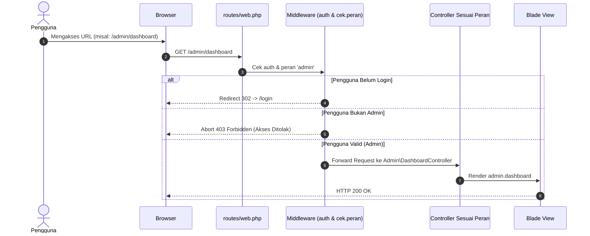
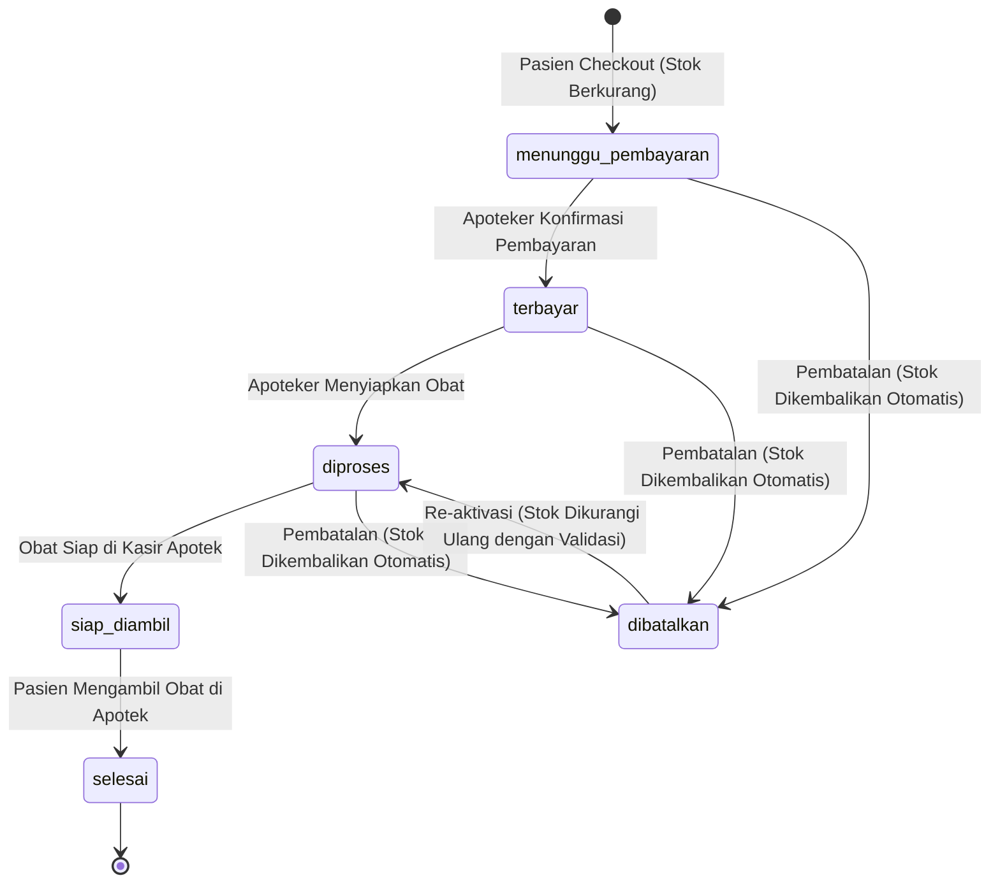
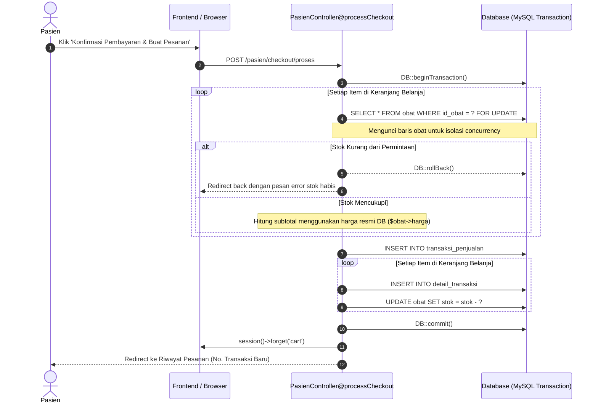

# SYSTEM ARCHITECTURE

Dokumen ini menjelaskan arsitektur teknis, pola desain, batas komponen, alur otentikasi, diagram status pesanan, serta manajemen concurrency pada aplikasi Apotek Celine.

---

## 1. Arsitektur Berlapis (Layered Architecture)

Aplikasi dibangun di atas framework Laravel 10 mengadopsi pola MVC (Model-View-Controller) dengan pemisahan tanggung jawab yang jelas:

```
[ Browser Client ]
       │
       ▼ (HTTP Request / HTTPS)
[ HTTP Kernel & Global Middleware ] (CORS, TrimStrings, EncryptCookies, StartSession)
       │
       ▼
[ Routing Layer: routes/web.php ]
       │
       ▼
[ Route Middleware ]
  ├── auth (Verifikasi session login pengguna)
  └── cek.peran:admin|apoteker|pasien (Role-Based Access Control)
       │
       ▼
[ Controllers Layer ]
  ├── Auth\ (Login, Register, Google OAuth)
  ├── Admin\ (Obat, User, Transaksi, Laporan PDF)
  ├── Apoteker\ (Transaksi Resep & Non-Resep, Pesanan Online, Laporan)
  └── Pasien\ (Katalog, Keranjang Session, Checkout Transaksi, Riwayat)
       │
       ▼
[ Domain & Model Layer (Eloquent ORM) ]
  ├── User, Peran, Pasien, Obat
  └── TransaksiPenjualan, DetailTransaksi, PasienDenganResep
       │
       ▼
[ Database Layer: MySQL / SQLite (Testing) ]
```

---

## 2. Alur Autentikasi & Otorisasi Berbasis Peran (RBAC)

Aplikasi menggunakan role-based access control melalui relasi `users.id_peran -> peran.id`. Setiap peran diarahkan ke dashboard khusus:



### Mekanisme Pengalihan (`/redirect`)
Saat pengguna berhasil login (baik via kredensial form maupun Google OAuth), pengguna diarahkan ke rute sentral `/redirect`:
- Jika `isAdmin()` -> dialihkan ke `admin.dashboard` (`/admin/dashboard`).
- Jika `isApoteker()` -> dialihkan ke `apoteker.dashboard` (`/apoteker/dashboard`).
- Jika `isPasien()` -> dialihkan ke `pasien.dashboard` (`/pasien/dashboard`).
- Jika peran tidak dikenali -> memicu HTTP 403.

---

## 3. Siklus Hidup Pesanan & Konservasi Stok (Order State Machine)

Setiap pesanan online yang dibuat oleh pasien melalui checkout melewati serangkaian status operasional yang dikelola oleh staf apotek:



### Aturan Konservasi Stok:
1. **Saat Pembuatan Pesanan:** Stok obat langsung dipotong (`decrement`) di dalam database transaction dengan `Obat::lockForUpdate()` untuk mencegah race condition.
2. **Saat Pembatalan Pesanan (`dibatalkan`):** Seluruh item pada `detail_transaksi` otomatis dikembalikan (`increment`) ke stok master obat.
3. **Saat Re-aktivasi:** Jika pesanan dibatalkan hendak diproses kembali, sistem memvalidasi kecukupan stok fisik terlebih dahulu sebelum memotong kembali.

---

## 4. Alur Transaksi Checkout Pasien (Concurrency Safe Flow)



---

## 5. Manajemen Berkas & Aset (File Storage)

- Berkas foto obat diunggah oleh Admin melalui modul `Admin\ObatController`.
- File disimpan menggunakan driver filesystem `public` Laravel (`storage/app/public/obat_photos/`).
- Akses berkas melalui web dilayani melalui symlink `public/storage` yang terhubung ke `storage/app/public`.
- Generator PDF menggunakan pustaka `barryvdh/laravel-dompdf` yang merender template Blade khusus cetak secara headless di sisi server.
