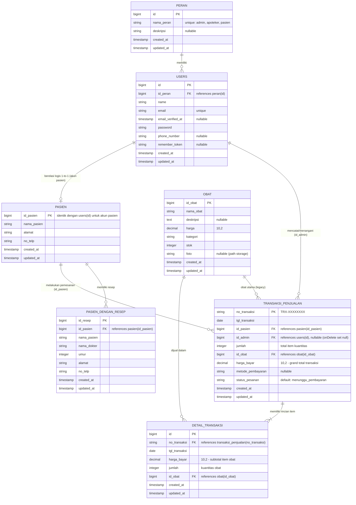

# ENTITY RELATIONSHIP DIAGRAM (ERD) & DATA DICTIONARY

Dokumen ini mendokumentasikan skema basis data relasional aktual sistem Apotek Celine berdasarkan file migrasi resmi pada `database/migrations/`.

---

## 1. Diagram Hubungan Entitas (Mermaid ERD)

---

## 2. Kamus Data (Data Dictionary)

### 2.1 Tabel `peran`
Menyimpan daftar master hak akses pengguna sistem.
- `id` (BIGINT, Primary Key, Auto Increment)
- `nama_peran` (VARCHAR 255, Unique): Nama peran, yaitu `admin`, `apoteker`, atau `pasien`.
- `deskripsi` (VARCHAR 255, Nullable): Keterangan deskriptif cakupan wewenang peran.
- `created_at` / `updated_at` (TIMESTAMP)

### 2.2 Tabel `users`
Menyimpan kredensial akun pengguna untuk autentikasi sistem.
- `id` (BIGINT, Primary Key, Auto Increment)
- `id_peran` (BIGINT, Foreign Key -> `peran.id`, Nullable, Default: 3 [pasien]): Menentukan role otorisasi.
- `name` (VARCHAR 255): Nama lengkap pengguna.
- `email` (VARCHAR 255, Unique): Alamat email resmi untuk login.
- `email_verified_at` (TIMESTAMP, Nullable): Waktu verifikasi email (otomatis diisi saat login Google).
- `password` (VARCHAR 255): Hash kata sandi akun (Bcrypt).
- `phone_number` (VARCHAR 20, Nullable): Nomor kontak telepon.
- `remember_token` (VARCHAR 100, Nullable): Token remember-me sesi.
- `created_at` / `updated_at` (TIMESTAMP)

### 2.3 Tabel `pasien`
Menyimpan profil identitas pasien/pelanggan apotek.
- `id_pasien` (BIGINT, Primary Key): ID unik pasien. Pada registrasi akun online, nilai ini berkorespondensi 1-ke-1 dengan `users.id`.
- `nama_pasien` (VARCHAR 255): Nama pasien.
- `alamat` (VARCHAR 255): Alamat domisili tempat tinggal pasien.
- `no_telp` (VARCHAR 20): Nomor telepon kontak aktif pasien.
- `created_at` / `updated_at` (TIMESTAMP)

### 2.4 Tabel `obat`
Menyimpan inventaris master katalog produk obat yang dijual apotek.
- `id_obat` (BIGINT, Primary Key, Auto Increment)
- `nama_obat` (VARCHAR 255): Nama dagang produk obat.
- `deskripsi` (TEXT, Nullable): Informasi indikasi, dosis, atau deskripsi obat.
- `harga` (DECIMAL 10,2): Harga jual satuan resmi obat.
- `kategori` (VARCHAR 255): Golongan obat (misal: Analgesik, Antibiotik, Vitamin).
- `stok` (INTEGER): Jumlah stok fisik obat yang tersedia di apotek.
- `foto` (VARCHAR 255, Nullable): Path relatif penyimpanan gambar produk di storage publik (`obat_photos/...`).
- `created_at` / `updated_at` (TIMESTAMP)

### 2.5 Tabel `pasien_dengan_resep`
Menyimpan arsip resep dokter yang dilayani oleh staf apoteker.
- `id_resep` (BIGINT, Primary Key, Auto Increment)
- `id_pasien` (BIGINT, Foreign Key -> `pasien.id_pasien`, Cascade Delete)
- `nama_pasien` (VARCHAR 255): Nama pasien yang tercantum di resep dokter.
- `nama_dokter` (VARCHAR 255): Nama dokter yang menerbitkan resep.
- `umur` (INTEGER): Usia pasien saat berobat.
- `alamat` (VARCHAR 255): Alamat pasien sesuai resep.
- `no_telp` (VARCHAR 20): Nomor telepon pasien sesuai resep.
- `created_at` / `updated_at` (TIMESTAMP)

### 2.6 Tabel `transaksi_penjualan`
Menyimpan header rekaman transaksi penjualan, baik pemesanan online pasien maupun transaksi walk-in kasir apotek.
- `no_transaksi` (VARCHAR 255, Primary Key): Kode unik transaksi (format `TRX-XXXXXXXX`).
- `tgl_transaksi` (DATE): Tanggal terjadinya transaksi.
- `id_pasien` (BIGINT, Foreign Key -> `pasien.id_pasien`, Cascade Delete): Pelanggan pemesan obat.
- `id_admin` (BIGINT, Foreign Key -> `users.id`, Nullable, `onDelete('set null')`): Staf admin/apoteker penanggung jawab transaksi. Bernilai `NULL` jika dipesan online mandiri oleh pasien.
- `jumlah` (INTEGER): Akumulasi total kuantitas obat dalam transaksi ini.
- `id_obat` (BIGINT, Foreign Key -> `obat.id_obat`): Kolom legacy penanda obat utama dalam transaksi.
- `harga_bayar` (DECIMAL 10,2): Total nominal pembayaran transaksi (Grand Total).
- `metode_pembayaran` (VARCHAR 255, Nullable): Metode pembayaran (misal: `transfer_bank_ambil_apotek`).
- `status_pesanan` (VARCHAR 255, Default: `'menunggu_pembayaran'`): Status alur pesanan (`menunggu_pembayaran`, `terbayar`, `diproses`, `siap_diambil`, `selesai`, `dibatalkan`).
- `created_at` / `updated_at` (TIMESTAMP)

### 2.7 Tabel `detail_transaksi`
Menyimpan rincian item per produk obat yang dibeli dalam satu transaksi.
- `id` (BIGINT, Primary Key, Auto Increment)
- `no_transaksi` (VARCHAR 255, Foreign Key -> `transaksi_penjualan.no_transaksi`, Cascade Delete)
- `tgl_transaksi` (DATE): Tanggal transaksi.
- `harga_bayar` (DECIMAL 10,2): Subtotal harga untuk item baris ini (`harga_satuan * jumlah`).
- `jumlah` (INTEGER): Kuantitas obat yang dibeli pada baris ini.
- `id_obat` (BIGINT, Foreign Key -> `obat.id_obat`, Cascade Delete): Referensi ke master obat.
- `created_at` / `updated_at` (TIMESTAMP)
